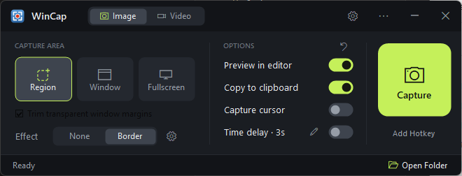

# WinCap

Windows용 가벼운 화면 캡처 도구입니다. 영역, 창, 전체 화면을 캡처해서 파일로 저장하고, 클립보드 복사와 편집기 열기까지 한 번에 처리합니다. 전역 단축키로 마지막 캡처 영역을 바로 다시 찍을 수 있어서, 같은 화면을 여러 번 캡처하는 작업(문서 작성, 버그 재현 기록 등)에 특히 편합니다.



## 주요 기능

- **세 가지 캡처 방식:** 영역(Region), 창(Window), 전체 화면(Fullscreen)
- **정밀한 영역 선택:** 돋보기, 픽셀 좌표와 색상 표시, 화살표 키로 1px 조정, `Shift`로 느린 마우스
- **그림자 여백 자동 제거:** WPF, Electron 같은 창의 투명한 그림자 여백을 빼고 창 내용만 캡처
- **고해상도 모니터 보정:** 125%, 175% 같은 배율의 모니터에서 캡처해도 100% 크기로 저장 (선택)
- **캡처 후 자동 처리:** 파일 저장, 클립보드 복사, 외부 편집기로 열기
- **테두리 효과:** 캡처 이미지에 원하는 색과 두께의 테두리 추가
- **지연 캡처:** 1~60초 카운트다운 뒤 캡처. 메뉴나 툴팁처럼 마우스를 대고 있어야 보이는 화면을 찍을 때 유용
- **전역 단축키:** 다른 프로그램을 쓰는 중에도 단축키 한 번으로 마지막 캡처 영역을 다시 캡처
- **다크 테마 UI**, 모니터별 DPI 대응(PerMonitorV2)

## 사용법

### 1. 캡처 방식 고르기 (CAPTURE AREA)

| 방식 | 동작 |
|---|---|
| **Region** | 화면이 멈춘 상태로 어둡게 바뀌고, 마우스로 드래그해서 영역을 고릅니다. |
| **Window** | 마우스를 올린 창이 강조되고, 클릭하면 그 창을 캡처합니다. |
| **Fullscreen** | 모든 모니터를 합친 전체 화면을 바로 캡처합니다. |

**Trim transparent window margins** (Window 방식, 기본 켜짐): 사용자 정의 타이틀바를 쓰는 앱 중에는 창 둘레에 보이지 않는 그림자 여백이 있는 경우가 있습니다. 이 옵션을 켜 두면 그 여백을 빼고 실제 창 내용만 캡처합니다.

### 2. Capture 버튼 누르기

WinCap 창은 캡처하는 동안 잠시 숨겨지므로 결과물에 찍히지 않습니다.

### Region 선택 조작법

| 조작 | 동작 |
|---|---|
| 마우스 드래그 | 영역 선택 후 캡처 |
| `Space` → 마우스 이동 → `Space` / 클릭 / `Enter` | 버튼을 누르고 있지 않아도 되는 선택 방식 |
| `Shift` 누른 채 마우스 이동 | 커서가 1/4 속도로 움직여 정밀하게 위치 지정 |
| 화살표 키 | 커서를 1px씩 이동 (`Space` 전에는 시작점, 이후에는 끝 모서리 조정) |
| `Esc` 또는 마우스 오른쪽 클릭 | 취소 (Window 방식에서도 같음) |

영역을 고르는 동안 주 모니터 왼쪽 위에 **돋보기**가 나타납니다. 커서 주변 40×40px을 5배로 확대해 보여 주고, 좌표와 픽셀 색상(선택 중에는 영역 크기)을 함께 표시합니다. 커서가 돋보기에 가까워지면 돋보기는 오른쪽 위로 비켜납니다.

### 캡처 옵션 (OPTIONS)

| 옵션 | 설명 | 기본값 |
|---|---|---|
| **Preview in editor** | 저장한 파일을 외부 편집기로 엽니다. | 켜짐 (그림판) |
| **Copy to clipboard** | 캡처 이미지를 클립보드에 복사합니다. 바로 붙여넣기할 수 있습니다. | 켜짐 |
| **Capture cursor** | 마우스 커서를 이미지에 포함합니다. | 꺼짐 |
| **Time delay** | 지정한 초만큼 기다린 뒤 캡처합니다. 연필 버튼으로 시간을 바꿉니다. 기다리는 동안 화면 왼쪽 위에 카운트다운이 표시되고, `Esc`를 누르면 취소됩니다. | 꺼짐 (3초) |
| **Effect** | `Border`를 고르면 테두리를 넣습니다. 옆의 톱니바퀴로 색과 두께(1~50px)를 정합니다. | Border, #404040, 2px |

↺ 버튼을 누르면 위 옵션이 모두 기본값으로 돌아갑니다.

### 전역 단축키

Capture 버튼 아래의 **Add Hotkey**를 눌러 단축키를 정합니다(처음에는 `Ctrl+Shift+Alt+R`을 제안합니다).

- 단축키를 누르면 **마지막으로 캡처한 영역을 같은 위치에서 다시 캡처**합니다. 영역을 다시 고를 필요가 없습니다.
- 아직 캡처한 적이 없으면 현재 설정대로 일반 캡처를 시작합니다.
- 다른 프로그램이 이미 쓰고 있는 조합이면 등록되지 않고, 버튼에 `(in use)`로 표시됩니다.

### 저장되는 파일

- 파일 이름: `Capture_yyyyMMdd_HHmmss_fff.png` (예: `Capture_20261128_143015_120.png`)
- 기본 저장 폴더: `사진\WinCap`
- 형식: PNG, JPG(품질 95), BMP 중 선택
- 하단 상태바에 저장 결과(크기, 경로)가 표시됩니다. 오른쪽 **Open Folder** 버튼이나 상태바 더블클릭으로 저장 폴더를 열 수 있고, 마지막 캡처 파일이 선택된 상태로 열립니다.

**100% 크기로 저장 (기본 켜짐):** 배율이 175%인 모니터에서 175px로 보이는 영역은 100% 크기인 100px로 줄여 저장합니다. 어느 모니터에서 캡처하든 문서에 넣었을 때 크기가 일정합니다. 클립보드에는 화면에 보이는 원래 해상도 그대로 복사됩니다.

## 설정과 메뉴

타이틀바 오른쪽의 **톱니바퀴**는 Settings 창을 엽니다.

| 설정 | 설명 |
|---|---|
| Save folder | 캡처 파일을 저장할 폴더 |
| Image format | PNG / JPG / BMP |
| Save at 100% scale | 위의 "100% 크기로 저장" |
| Editor program | Preview in editor에서 쓸 프로그램 (기본 `mspaint.exe`) |
| Start WinCap when Windows starts | Windows 로그인 시 자동 실행 |

**⋯ 메뉴**에는 다음 항목이 있습니다.

- Capture, Open Capture Folder
- Copy Last Capture: 마지막 캡처 파일을 클립보드에 다시 복사
- Open Last Capture in Editor
- Hotkey..., Settings...
- Always on Top: WinCap 창을 항상 위에 표시
- About WinCap
- Check for Updates...: GitHub의 최신 릴리스를 확인하고 내려받아 설치 (아래 "업데이트" 참고)
- Exit

모든 설정은 `%APPDATA%\WinCap\settings.json`에 자동 저장되고, 다음 실행 때 그대로 복원됩니다.

## 업데이트

⋯ 메뉴 › **Check for Updates...** 를 누르면 [GitHub Releases](https://github.com/stjeong/WinCap/releases)의 최신 버전을 확인합니다. 새 버전이 있으면 릴리스 노트를 보여 주고, **Download and Install**을 누르면 설치 방식에 맞게 업데이트합니다.

| 설치 방식 | 업데이트 동작 |
|---|---|
| zip (포터블) | 새 zip을 내려받아 실행 중인 `WinCap.exe`를 교체한 뒤 WinCap을 다시 시작합니다. 이전 exe는 `WinCap.exe.old`로 잠시 남았다가 다음 실행 때 지워집니다. exe가 쓰기 권한이 없는 폴더(예: Program Files)에 있으면 교체할 수 없으므로, 내려받은 파일 위치를 알려 줍니다. |
| MSIX | 새 `.msix`를 내려받아 Windows 앱 설치 관리자로 열고 WinCap을 종료합니다. 릴리스가 자체 서명 인증서로 서명되어 있고 그 인증서를 아직 신뢰하지 않았다면, 인증서를 이 PC의 Trusted People 저장소에 추가할지 묻습니다 (관리자 권한 필요). |
| 개발 빌드 (Visual Studio 등에서 실행) | 스스로 업데이트하지 않고 릴리스 페이지만 엽니다. |

내려받은 파일은 `%TEMP%\WinCap-update\<태그>\`에 저장됩니다.

## 요구 사항

- Windows 11 이상, x64
- 실행: .NET 9 Desktop Runtime
- 빌드: .NET 9 SDK (Visual Studio 2022 17.12 이상)

## 빌드와 실행

**Visual Studio:** `WinCap.sln`을 열고 `Debug | x64`로 F5

**명령줄:**

```
dotnet build WinCap.sln -c Release -p:Platform=x64
```

결과물은 `src\WinCap\bin\x64\Release\net9.0-windows\WinCap.exe`입니다. 전역 단축키는 한 프로그램만 등록할 수 있으므로 WinCap은 한 번에 하나만 실행됩니다.

## 배포 파일 만들기 (zip, MSIX)

`packaging/package.ps1`이 배포 파일을 만듭니다. .NET을 설치하지 않은 PC에서도 실행되도록 self-contained 단일 exe로 빌드합니다.

| 파일 | 설명 |
|---|---|
| `WinCap-<버전>-win-x64.zip` | 압축을 풀고 `WinCap.exe`를 바로 실행하는 포터블 버전 |
| `WinCap-<버전>-x64.msix` | 설치 패키지 (Windows 11, x64) |
| `WinCap-<버전>-selfsigned.cer` | 서명 인증서를 주지 않았을 때만 생성. MSIX를 설치하기 전에 신뢰해야 하는 자체 서명 인증서 |

**로컬에서:** .NET 9 SDK와 Windows SDK(`makeappx`, `makepri`, `signtool`)가 필요합니다. 결과는 `artifacts\`에 생깁니다.

```
pwsh packaging/package.ps1 -Version 1.0.0
pwsh packaging/package.ps1 -Version 1.0.0 -CertificatePath my.pfx -CertificatePassword ****
```

**GitHub Actions (`.github/workflows/release.yml`):**

- `v1.2.3` 형식의 태그를 push하면 빌드한 뒤 GitHub Release를 만들고 파일을 첨부합니다.

  ```
  git tag v1.0.0
  git push origin v1.0.0
  ```

- Actions 탭에서 **Release › Run workflow**로 수동 실행하면 Release는 만들지 않고, 빌드 결과를 워크플로 아티팩트로만 올립니다. 버전을 비우면 `WinCap.csproj`의 `<Version>`을 씁니다.
- 저장소 Secrets에 `MSIX_CERTIFICATE`(PFX 파일을 base64로 인코딩한 값)와 `MSIX_CERTIFICATE_PASSWORD`를 넣으면 그 인증서로 서명합니다. 이때 MSIX의 Publisher는 인증서 subject를 따릅니다. Secrets가 없으면 빌드할 때마다 자체 서명 인증서를 새로 만들고, 릴리스 노트에 인증서 설치 방법을 넣습니다.

  ```
  [Convert]::ToBase64String([IO.File]::ReadAllBytes('my.pfx')) | Set-Clipboard
  ```

## 알려진 제한

- **Video** 탭은 UI만 있고 동영상 녹화는 아직 구현되지 않았습니다.
- 캡처 후 편집 기능은 없으며, 외부 편집기(기본: 그림판)를 사용합니다.
- MSIX로 설치한 경우 Settings의 **Start WinCap when Windows starts**가 동작하지 않습니다. MSIX 앱은 레지스트리 쓰기가 앱 전용 공간으로 격리되기 때문입니다. 자동 실행이 필요하면 zip 버전을 쓰세요.

## 프로젝트 구조

```
WinCap.sln
global.json                  .NET SDK 버전 고정 (9.0)
docs/                        README용 스크린샷
packaging/                   배포 파일 생성 스크립트(package.ps1), MSIX 매니페스트 템플릿
.github/workflows/           release.yml: 태그 push 시 zip·MSIX 빌드와 GitHub Release
src/WinCap/
  Program.cs                 진입점 (단일 인스턴스, PerMonitorV2, 다크 모드)
  MainForm(.Designer).cs     메인 UI와 캡처 흐름
  Capture/                   화면 캡처, 영역·창 선택 오버레이, 돋보기, 카운트다운,
                             테두리 효과, 창 열거, 투명 여백 제거
  Controls/                  Theme(색상), SegmentedControl, AccentButton, ToggleSwitch,
                             다크 메뉴 렌더러
  Dialogs/                   Settings, Border, Time Delay, Hotkey, Update 대화상자
  Hotkeys/                   단축키 입력과 표시
  Native/                    Win32 P/Invoke
  Settings/                  AppSettings(JSON 저장), 시작 프로그램 등록
  Updates/                   GitHub Releases 확인·다운로드, 포터블/MSIX 업데이트 설치
```
